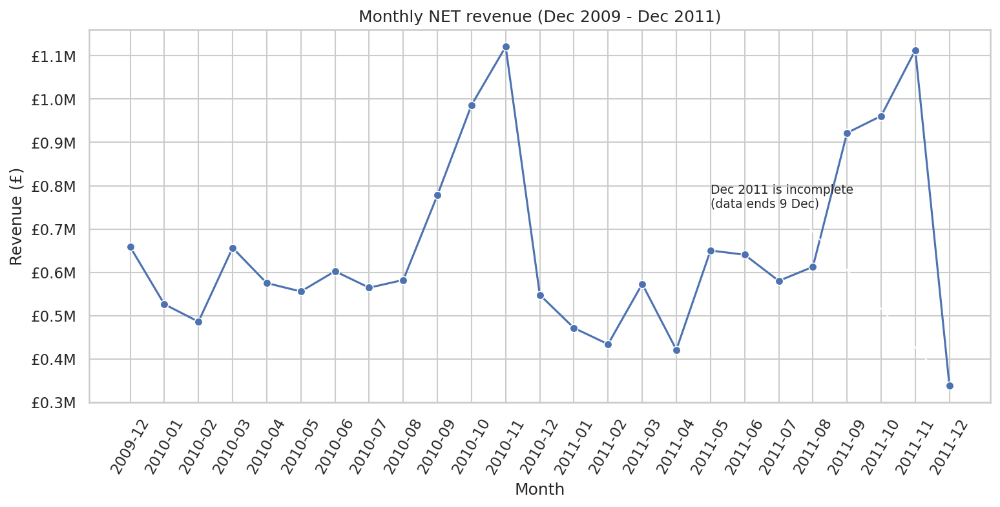
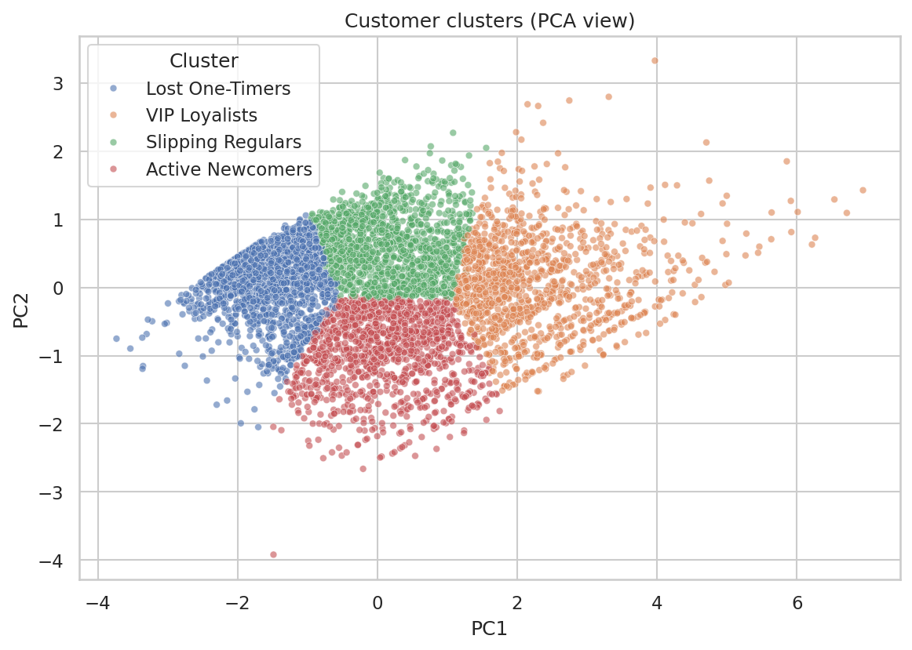
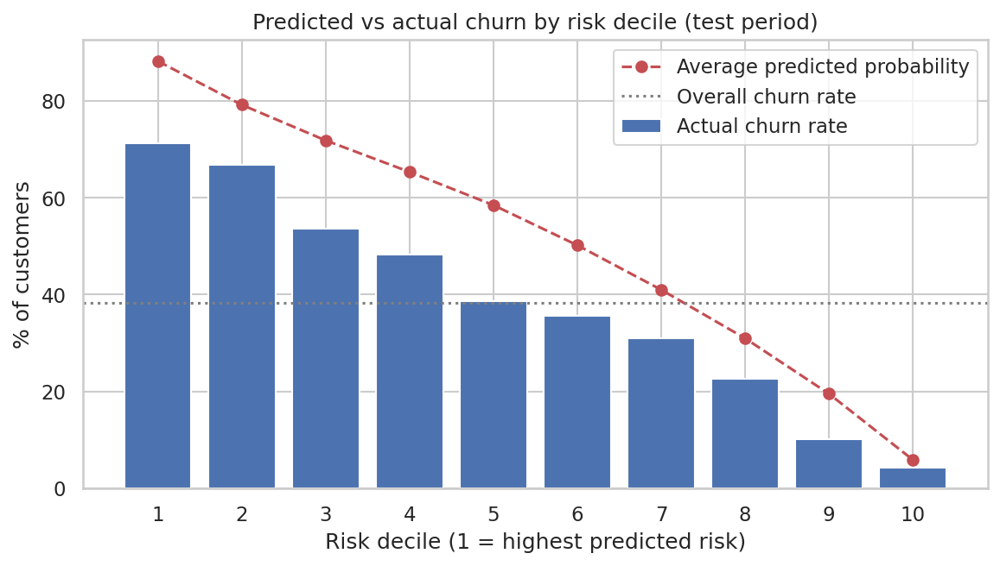
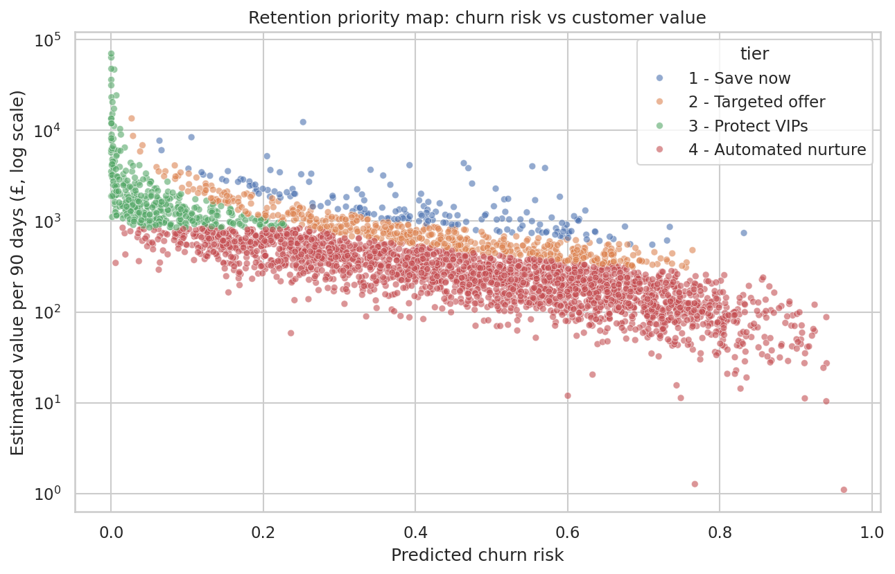

# E-Commerce Customer Segmentation & Retention
**Python · SQL (MySQL) · Machine Learning** — an end-to-end analytics project by **Priyanshu**, aspiring Data Analyst

> **One-line summary:** I cleaned 1.07 million e-commerce transactions, segmented 5,800+ customers with SQL (RFM) and K-Means, built a churn-prediction model, and turned it into a prioritised retention list ranked by expected revenue loss.

---

## 1. Business problem
An online wholesale retailer makes most of its money from repeat customers, but it does not know **who its best customers are, who is about to stop buying, and who to contact first.**
This project answers three questions:
1. **Who are our customers?** (segmentation)
2. **Who is likely to leave in the next 90 days?** (churn prediction)
3. **Whom should the retention team contact first, and with what?** (prioritised action list)

## 2. Dataset
**Online Retail II** (UCI Machine Learning Repository): real transactions of a UK-based online gift retailer, **1 Dec 2009 – 9 Dec 2011**, 1,067,371 rows, 8 columns (invoice, product, quantity, date, price, customer ID, country).
> I used a copy of the file that was published in a public GitHub project. Please check the original source and licence on the UCI page before reusing the data.

## 3. Tools & skills used
| Area | What I used |
|---|---|
| Python | pandas, NumPy, Matplotlib, Seaborn, scikit-learn (K-Means, PCA, Logistic Regression, Random Forest, GridSearchCV), SQLAlchemy |
| SQL (MySQL) | CTEs, window functions (`LAG`, `RANK`, `DENSE_RANK`, `NTILE`, `PERCENT_RANK`, `ROW_NUMBER`, `SUM() OVER`), `LEFT JOIN`, `UNION ALL`, conditional aggregation, stored procedure with `IN` parameters |
| Analytics | Data cleaning & audit, EDA, RFM, cohort retention, clustering, classification, model evaluation, business storytelling |

## 4. Project structure
```
ecommerce-customer-segmentation-retention/
├── README.md
├── requirements.txt
├── data/
│   ├── raw/online_retail_II.csv.gz        # original data (not modified)
│   └── processed/                          # cleaned data + SQL outputs + model scores
├── notebooks/
│   ├── 01_data_cleaning_and_eda.ipynb      # audit, cleaning log, EDA
│   ├── 02_rfm_kmeans_segmentation.ipynb    # SQL RFM vs K-Means
│   ├── 03_churn_prediction.ipynb           # time-based validation, model comparison, lift
│   └── 04_retention_strategy.ipynb         # risk x value, action list, scenario
├── sql/
│   ├── 01_create_schema_and_load.sql       # tables + LOAD DATA + sanity checks
│   ├── 02_business_analysis.sql            # 9 business questions (KPIs, MoM, Pareto, gaps...)
│   ├── 03_rfm_segmentation.sql             # RFM scores + segments (NTILE problem -> PERCENT_RANK fix)
│   ├── 04_cohort_retention.sql             # cohort retention table + average curve
│   ├── 05_churn_feature_engineering.sql    # stored procedure: leakage-free features + label
│   └── results/                            # CSV exports of every query result
├── src/                                    # db_utils.py (MySQL connection), churn_utils.py (features)
├── models/churn_model.joblib               # final churn model
├── outputs/                                # deliverables: action list, win-back list, summaries
├── images/                                 # all charts
└── docs/                                   # data dictionary, interview prep, resume text
```

## 5. How to run it
Order matters because each step feeds the next:
```
notebook 01  ->  sql/01 ... sql/05  ->  notebook 02 -> notebook 03 -> notebook 04
```
1. `pip install -r requirements.txt`
2. Run `notebooks/01_data_cleaning_and_eda.ipynb` (creates the clean CSVs).
3. In MySQL (Workbench or CLI), run the files in `sql/` **in order** (01 → 05). The file paths in `01_...sql` assume you run from the `sql/` folder. `LOAD DATA LOCAL INFILE` needs `local_infile` enabled (instructions are in the file).
4. Set your database login as environment variables, then start Jupyter:
   - Windows PowerShell: `$env:DB_USER="root"; $env:DB_PASSWORD="your_password"`
   - Mac/Linux: `export DB_USER=root DB_PASSWORD=your_password`
5. Run notebooks 02 → 03 → 04.

*No MySQL? Notebooks 02-04 automatically fall back to the CSV files exported from the SQL step (`data/processed/`), so they still run.*

---

## 6. Pipeline & key findings

### Step 1 · Cleaning & EDA (Python)
- **1,067,371 → 776,579 rows** (72.8% kept). Removed 34,335 duplicates, 235,151 rows with no Customer ID, moved 18,390 cancellation lines to a separate table, dropped postage/fees/test codes.
- Every cleaning step is **logged**, and `assert` checks verify the result.
- **Hidden problem found:** 4 of the 5 largest order lines (up to £168k) were **later cancelled**. Using gross sales would have made two customers look like top clients. I measure money as **net revenue (sales − returns)** everywhere.
- Business picture: £16.4M net revenue, strong **Sept–Nov seasonality**, UK ≈ 84% of revenue, **top 20% of customers ≈ 77% of net revenue**, B2B-like pattern (almost no Saturday orders).



### Step 2 · SQL analysis & RFM (MySQL)
- Answered 9 business questions (KPIs, MoM growth with `LAG`, country share, top products, revenue deciles, new vs returning customers, order gaps, return rate).
- **~81% of re-orders happen within 90 days** → basis for the churn definition.
- **RFM evaluation:** my first scoring used `NTILE(5)`. A test showed it gave **different scores to customers with identical frequency** (e.g. 1,599 one-order customers were split across two scores). I replaced it with `PERCENT_RANK()` and re-tested: zero unfair cases.
- Result: *Champions* = 24% of customers but 69% of revenue; *Hibernating* = 28% of customers but 4% of revenue.
- Cohort analysis: only ~1 in 5 new customers buys in any later month; activity dips around months 10–11 and rebounds at month 12 (the next autumn peak).

### Step 3 · K-Means segmentation (Python)
- Raw-data K-Means gave useless clusters (sizes 4 and 37) **even though its silhouette score looked high (0.59)** → log-transform + standardise was necessary.
- Chose **k = 4** using elbow + silhouette + business usefulness; stability check (ARI ≥ 0.996 over 5 seeds).

| Cluster | Customers | Revenue share | Behaviour |
|---|---|---|---|
| VIP Loyalists | 20% | **74%** | ordered ~4 weeks ago, ~19 orders, ~£10k |
| Slipping Regulars | 25% | 16% | silent ~7 months, ~5 orders |
| Active Newcomers | 21% | 6% | recent, ~3 orders, ~£800 |
| Lost One-Timers | 33% | 4% | silent >1 year, ~1 order |



### Step 4 · Churn prediction (ML)
- **Definition:** no purchase in the 90 days after a cutoff date. Features come from a **SQL stored procedure** that only uses data *before* the cutoff (no leakage; checked in SQL).
- **Time-based validation:** train on the June cutoff, test on the later September cutoff.
- I tested the population choice: restricting to **active customers** (last order ≤ 180 days) gives AUC 0.76 vs 0.80 for all customers — the lower number is the honest one for the real task.

| Model (future test period) | ROC-AUC | PR-AUC |
|---|---|---|
| Baseline (no skill) | 0.50 | 0.38 |
| **Logistic Regression (chosen)** | **0.758** | **0.631** |
| Random Forest (tuned, 5-fold CV) | 0.761 | 0.634 |

- The tuned forest did **not** beat the simple model by a meaningful margin, so I chose the **explainable Logistic Regression**.
- Contacting the **top 30% of customers by risk reaches ~50% of all churners**.
- **Frequency** (number of orders) is by far the strongest driver (permutation importance).
- Found a **calibration shift**: probabilities are over-estimated in the test period because of seasonality → I use the output as a **ranking**.



### Step 5 · Retention strategy
- My first idea (high value × high risk grid) selected only **13 customers**. Diagnosis: value and risk are strongly **negatively correlated (Spearman −0.79)** because valuable customers buy often, which the model reads as "safe".
- Better approach: rank by **expected loss = churn risk × estimated 90-day value**.
  - **Tier 1 "Save now":** 173 customers (5%) hold **19%** of the expected loss → personal outreach
  - **Tiers 1 + 2:** 692 customers (20%) hold **45%** of the expected loss
  - **Tier 3 "Protect VIPs":** valuable & healthy → loyalty perks, **don't over-discount**
- A separate **win-back list** of 737 lapsed repeat buyers with £1.44M of past net spend.
- Deliverables: [`outputs/retention_action_list.csv`](outputs/retention_action_list.csv), [`outputs/winback_candidates.csv`](outputs/winback_candidates.csv)



---

## 7. Mistakes I made and what I learned
| What went wrong | How I found it | What I did |
|---|---|---|
| Biggest orders looked like top customers/products | Checked the top 5 lines | Found matching cancellations → switched to **net revenue** |
| Net revenue count changed between two runs | Re-ran and compared | Floating-point residue → `.round(2)` on money |
| `NTILE` scored identical customers differently | Wrote a fairness test in SQL | Switched to `PERCENT_RANK` |
| K-Means on raw data → clusters of 4 and 37 | Looked at cluster sizes, not just silhouette | Log-transform + standardise |
| All-customer churn model looked better than it was | Compared populations | Used active customers only |
| Churn probabilities too high in test period | Predicted-vs-actual by decile | Treat score as a ranking; flagged seasonality |
| Risk × value grid selected 13 customers | Checked group sizes | Found the −0.79 correlation → rank by expected loss |
| Wrote an insight about "top features" before checking | Compared text with output | Rewrote it: **frequency** dominates, not recency |

## 8. Limitations (honest list)
- Only ~2 years of data and 2 labelled churn periods; strong seasonality is hard to model with so little history.
- 22.8% of raw rows have no Customer ID; all results describe **identified customers only**.
- Only purchase behaviour is used — no marketing, product category, or customer-contact data.
- Churn probabilities are not calibrated; the "value" estimate is a simple proxy (net spend ÷ tenure × 90).
- Recommended actions are **hypotheses**; the right next step is an **A/B test** (contact half of Tier 1, keep the rest as a control).

## 9. Ideas for the next version
Rolling-window churn datasets (more cutoffs), product-category features, a Power BI dashboard on top of `customer_segments.csv` and the action list, and an A/B test design for Tier 1.

---
*Built as a learning project to practise the full analytics workflow: clean → query → model → recommend.*
